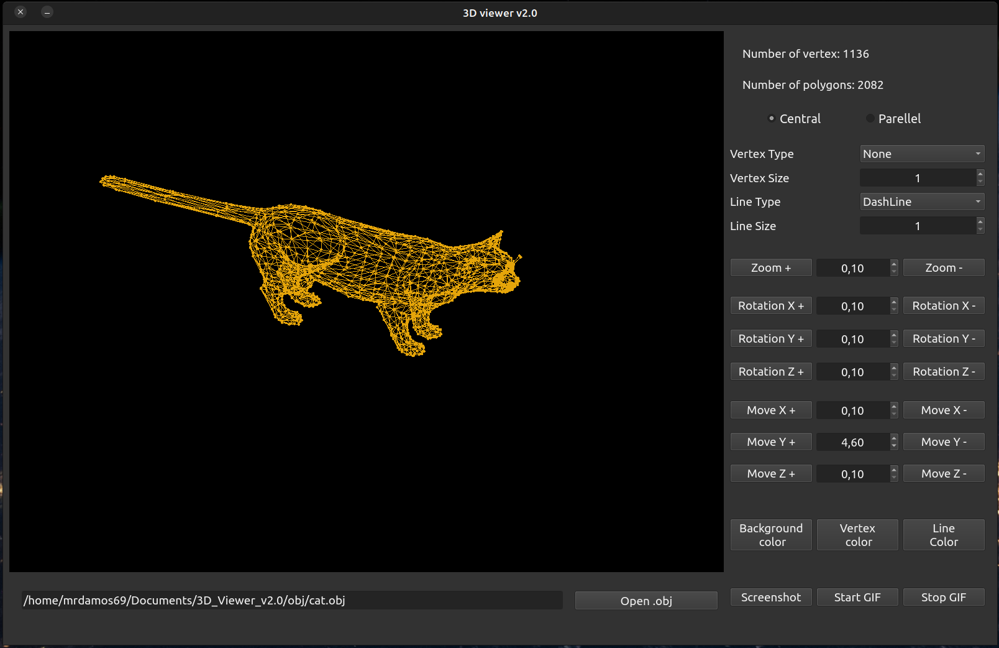

# 3D wireframe viewer

A C++17 desktop application for loading OBJ models and exploring them with Qt and OpenGL. The code separates parsing, geometric transformations and rendering through a model-view-controller structure.



## Capabilities

- Parse OBJ vertex and face data into a wireframe representation.
- Translate, rotate and scale the model.
- Switch projection and adjust line, vertex and background settings.
- Persist display settings with QSettings.
- Capture the viewport and export a GIF sequence.


## Code walkthrough

| Area | What it demonstrates |
|---|---|
| [OBJ parser](model/parser/) | File parsing and geometry input |
| [Transformations](model/transform/) | Geometric operations |
| [Matrix library](matrix_lib/) | Matrix operations used by the viewer |
| [Controller](controller/) | Connection between model and interface |
| [OpenGL widget](view/widget.cpp) | Rendering, projections and display settings |
| [Qt view](view/view.cpp) | Interaction and image export |
| [Tests](unit_test/unit_test.cc) | GoogleTest cases for the model |

## Build

Open [view/view.pro](view/view.pro) in Qt Creator using a Qt 6 desktop kit with Widgets, OpenGL and OpenGLWidgets, plus a C++17 compiler.

The existing Makefile exposes these entry points:

```bash
make install
make test
```

The install target expects qmake on PATH and a macOS `.app` bundle. The test target requires GoogleTest. Build setup may need adjustment on other platforms; no fresh cross-platform build or performance benchmark is claimed.

## Project scope

An earlier collaborative desktop-engineering project. The repository includes example models, screenshots and a recording. The screenshots show the existing interface, not a redesigned mockup.

The GIF export uses the bundled [QtGifImage library](QtGifImage-master/README.md). Its original attribution and license files remain in the repository.

## Contributors

- [Dmitrii Chichkanov](https://github.com/mrdamos69)
- [Ayzat Akhmetzyanov](https://github.com/AjzSAhmetzyanov)
